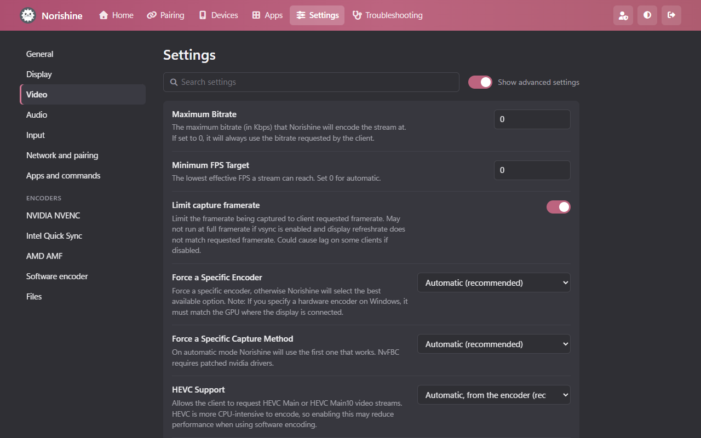
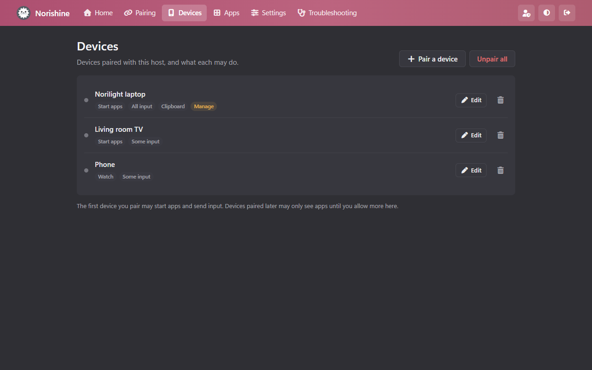
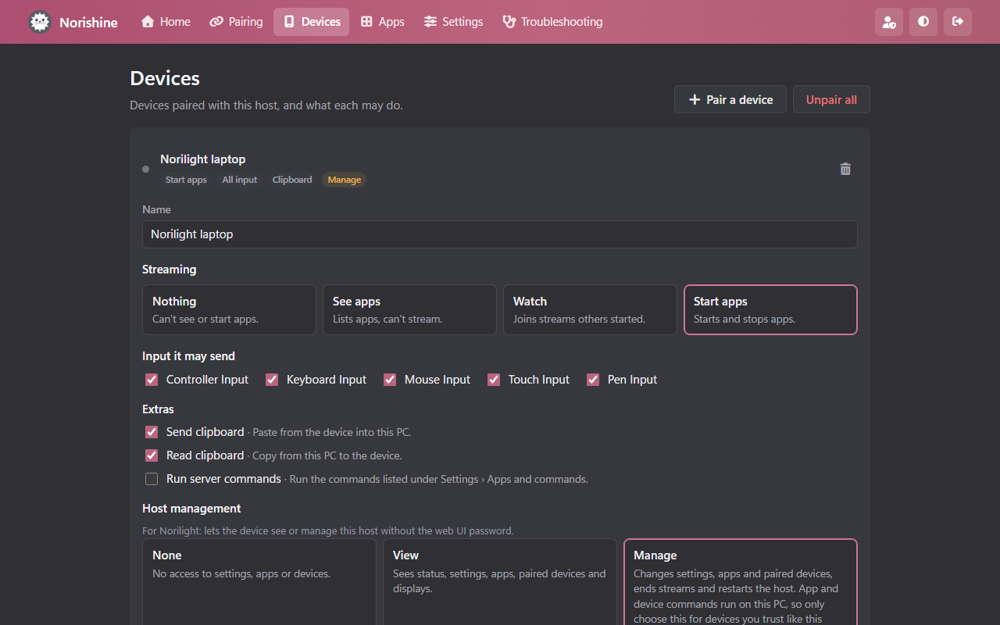
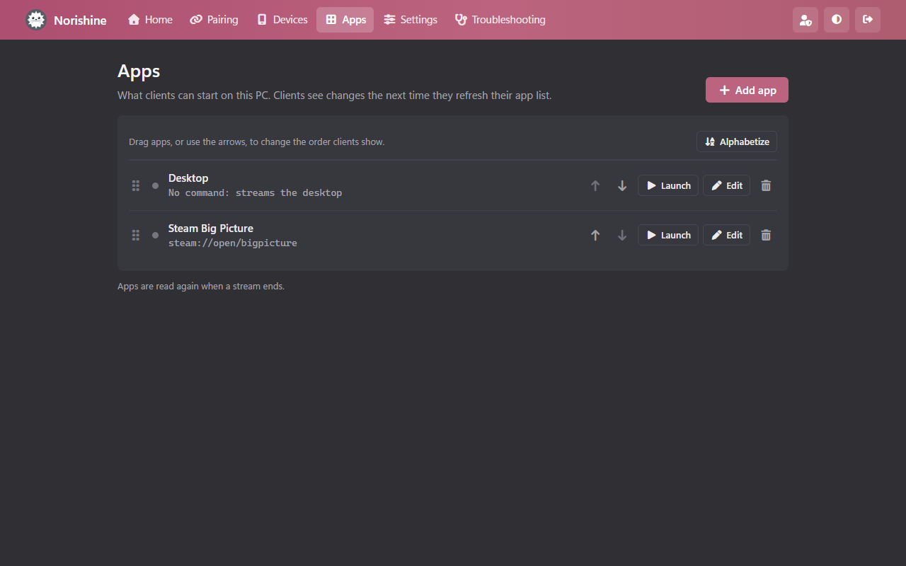

<p align="center">
  
</p>

<h1 align="center">Norishine</h1>

<p align="center"><em>A home for your games and desktop, wherever you stream.</em></p>

<p align="center">
  <a href="https://github.com/Nori-Oppi/Norishine/releases/tag/nightly"><strong>Download nightly</strong></a> ·
  <a href="#whats-inside">What's inside</a> ·
  <a href="#updating">Updating</a> ·
  <a href="docs/DEVELOPMENT.md">Build from source</a>
</p>

Norishine streams games and desktops from your PC to
[Norilight](https://github.com/Nori-Oppi/Norilight), Moonlight, Artemis and other
GameStream clients. It's the host half of the Nori project, built on
[Apollo](https://github.com/ClassicOldSong/Apollo) and
[Sunshine](https://github.com/LizardByte/Sunshine).

It keeps Apollo's **virtual displays**, **per-device permissions**, **OTP pairing**,
**clipboard sync** and **server commands**, and adds a searchable settings page and
host controls inside Norilight. Set up the host in your browser, then adjust its
streaming settings from the client when you need to.

<table>
  <tr>
    <td width="50%"><a href="docs/screenshots/settings.png"></a><br><strong>Settings</strong>: searchable, grouped, with help beside each setting.</td>
    <td width="50%"><a href="docs/screenshots/devices.png"></a><br><strong>Devices</strong>: what each paired device may do, at a glance.</td>
  </tr>
  <tr>
    <td><a href="docs/screenshots/device-permissions.png"></a><br><strong>Permissions</strong>: plain choices instead of permission bits.</td>
    <td><a href="docs/screenshots/apps.png"></a><br><strong>Apps</strong>: reorder, start, edit and remove apps.</td>
  </tr>
</table>


## Getting started

1. **Install on your host PC.** Download the Windows x64 installer from the
   [nightly release](https://github.com/Nori-Oppi/Norishine/releases/tag/nightly).
   Nightlies are unsigned development builds; there is no stable release yet.
2. **Set up the host.** Open Norishine's local web UI and create your web credentials.
   Use the pairing page to approve Norilight or another compatible client.
3. **Start streaming.** Pick Desktop or an application in your client. Norishine's
   SudoVDA integration provides virtual displays that can follow the client.
4. **Enable host controls in Norilight.** In the host's paired-device UI, grant
   **Read Host Settings** and, if needed, **Change Host Settings** to that device.
   Then right-click the host in Norilight and choose **Host Settings**.

### Coming from another host

The Windows installer can replace Apollo or Vibepollo and copy its settings, apps
and paired devices, or keep both hosts installed.

| Installation choice | What happens |
| --- | --- |
| **Replace Apollo or Vibepollo** | Copies its configuration to Norishine and uninstalls the previous host. |
| **Keep both** | Leaves the existing host installed and uses port **48989** for Norishine. |
| **Uninstall Norishine later** | Keeps a configuration copy for migration back and preserves shared drivers when another host needs them. |

Replacement has been tested on one machine. Fresh installation, coexistence and
migration back still need broader validation. Read the
[known issues and migration limits](docs/KNOWN-ISSUES.md) before switching hosts.

## What's inside

### Games, desktops and displays

- **Stream your PC.** Hardware-accelerated game and desktop streaming inherited from
  Apollo and Sunshine, with support for compatible GameStream clients.
- **A display for your client.** Virtual displays can follow the client's resolution
  and refresh rate through the SudoVDA integration.
- **Apollo extras included.** OTP pairing, text clipboard sync and host server
  commands remain available to clients that support them.

### Settings you can find and understand

- **Search instead of hunting.** Find settings from the web UI, with categories,
  Basic and Advanced views, and help beside the controls.
- **Check changes before saving.** The host validates values and reports errors for
  individual settings. Dangerous changes need confirmation, and settings that need
  a restart are marked.
- **Keep a recovery copy.** Configuration and state files are written atomically,
  with backups. Validated partial updates preserve unchanged configuration lines.
- **One settings definition.** The host describes its supported settings, defaults,
  ranges and restart requirements to both the web UI and Norilight.

### Host controls in Norilight

These need [Norilight](https://github.com/Nori-Oppi/Norilight) and the corresponding
device permissions on the host.

- **See the host's status** and search its settings without opening a browser.
- **Change settings from the client**, with errors shown beside rejected values.
- **Restart the host** from the same page when a change needs it.
- **Manage apps, paired devices and displays** from Norilight's Manage Host page: add,
  edit, start and reorder apps; change what each device may do, end its stream or
  unpair it; pick the display to stream.
- **Use the existing pairing.** Management authenticates with the paired client
  certificate; Norilight doesn't store the host's web administrator password.
- Settings containing lists or scripts remain editable through the host's web UI.

### Control what each device can do

- New devices start with **launch, view and input**, including the first device paired.
- Clipboard sync, server commands and host management each need explicit permission.
- Existing paired devices don't automatically receive management access.
- Sunshine security fixes are carried forward for packet validation, pairing,
  certificate matching, endpoint handling and log redaction. The
  [upstream sync record](docs/UPSTREAM-SYNC.md) records the individual changes.

### A web UI that's easier to use and harder to break into

- **Every page rebuilt** in the shared theme: home with the running app and active
  streams, pairing, devices and permissions, apps, settings, logs and troubleshooting.
- **Safer sign-in.** Passwords are stored with PBKDF2, every change needs a CSRF token,
  repeated failed sign-ins are slowed down, and you can sign out. Sign-ins survive a
  restart of the host.

## Updating

Download the latest installer from the
[nightly release](https://github.com/Nori-Oppi/Norishine/releases/tag/nightly).
The rolling pre-release is replaced when the nightly workflow builds a changed
`master`; CI builds the Windows installer and runs tests.

Nightlies are unsigned development builds. Check the download's commit when looking
for a specific feature: work on another branch may not be included yet. Windows x64
is the developed and tested target; Linux and macOS source is retained but isn't
currently verified here.

## Roadmap

Planned, not available yet:

- **Better diagnostics:** host statistics and per-session metrics (M8).
- **Guided tuning:** conservative recommendations with preview and rollback (M9).
- **Measured streaming improvements**, including display recovery after crashes (M10).

A hung session can still leave an orphaned virtual display. See
[known issues](docs/KNOWN-ISSUES.md) for the current limitations and the
[full roadmap](docs/ROADMAP.md) for architecture decisions and milestones.

## Development across branches

| Branch | Implemented work | Availability at review |
| --- | --- | --- |
| `security/remaining-advisories` | Remaining Sunshine security ports and persistent host identity | Included in remote `master` |
| `installer/other-hosts` | Replace/coexist installer, shared-driver handling, configuration copies and PATH cleanup | Included in remote `master` |
| `m1/settings-schema` | Settings schema, validated configuration API, atomic writes and backups | Included in remote `master` |
| `m5/client-management` | Capability discovery, paired-certificate management API and per-device grants | Included in remote `master` |
| `m6/host-strings` | Readable schema labels/help and paired-client restart endpoint | Included in remote `master` |
| `ci/nightly` | Rolling Windows nightly installer built through CI | Included in remote `master` |
| `phase3/m2-settings-ui` | Schema-driven settings page and shared visual theme | Included in remote `master` |
| `phase3/m3` | Remaining web pages, active-stream status, sign-in hardening and CSRF | Included in remote `master` |
| `phase3/m4` | Split state files with versioned migrations; sign-ins that survive a restart | Included in remote `master` |
| `phase3/m7-manage-api` | Apps, paired devices, streams and displays in the management API | Included in remote `master` |

Branch review: **16 November 2026**. Availability above describes the reviewed
commits, rather than a guarantee about an older nightly download.

## Building

Clone with submodules:

```sh
git clone --recursive https://github.com/Nori-Oppi/Norishine.git
```

Windows builds use **MSYS2 UCRT64**, CMake/Ninja and official Node.js. Follow
[Development](docs/DEVELOPMENT.md) for build commands, installer packaging, isolated
development hosts and end-to-end checks. The [general build notes](docs/building.md)
retain the upstream platform instructions.

For implementation details, see the [management API](docs/api.md) and
[initial research](docs/PHASE1-RESEARCH.md).

## Credits and license

Norishine builds on [Apollo](https://github.com/ClassicOldSong/Apollo) and
[Sunshine](https://github.com/LizardByte/Sunshine), alongside the Moonlight Game
Streaming Project. Thanks to their authors and to the projects that supply
Norishine's dependencies. The [original Apollo README](docs/APOLLO-README.md) is
preserved in this repository, along with upstream copyright notices and history.

Norishine is licensed under the GNU General Public License v3, like Apollo and
Sunshine. See [LICENSE](LICENSE). Bundled dependencies keep their own licenses.
