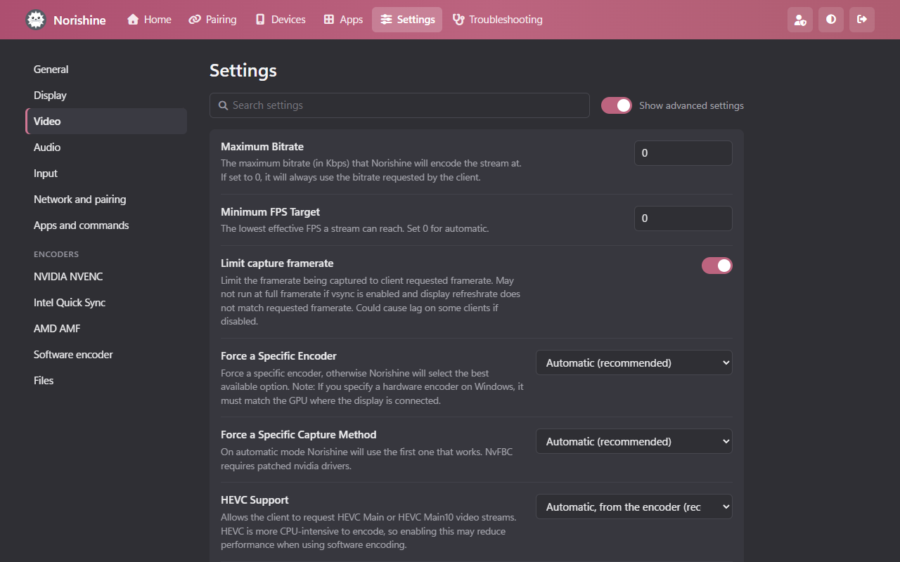
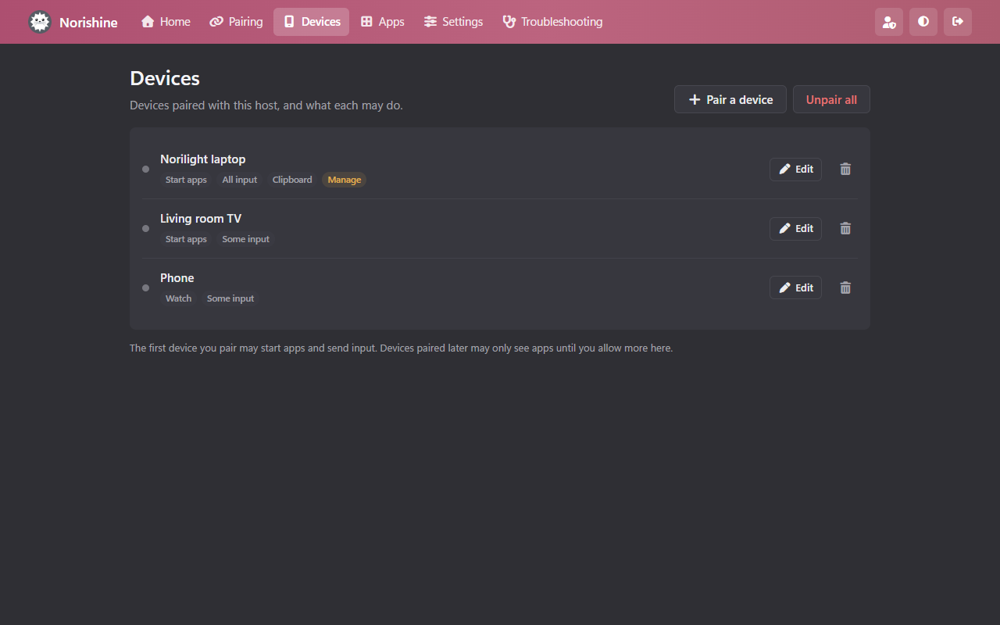
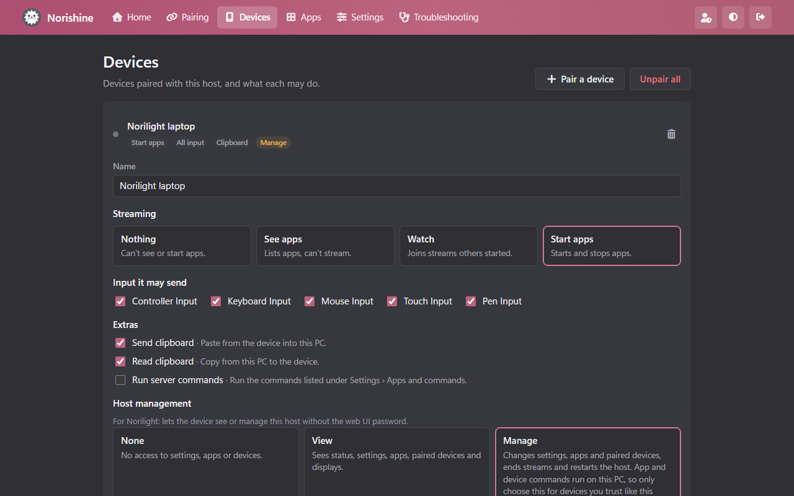
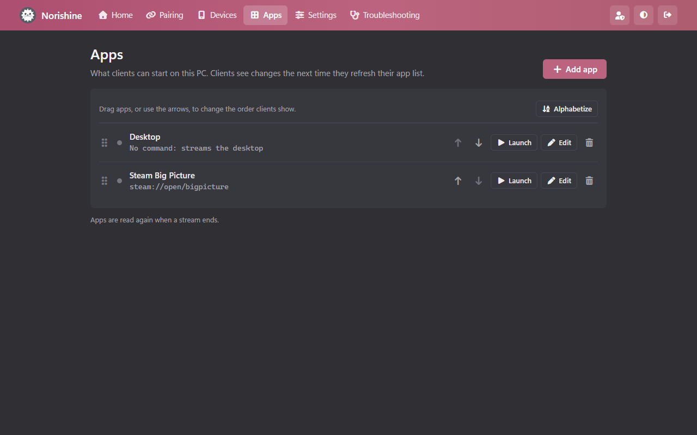

# What's in Norishine

## Games, desktops and displays

- **Stream your PC.** Hardware-accelerated game and desktop streaming from Apollo and
  Sunshine, for any compatible GameStream client.
- **A display for your client.** Virtual displays can follow the client's resolution and
  refresh rate through the SudoVDA integration.
- **Apollo extras.** OTP pairing, text clipboard sync and host server commands.

## A web UI you can find your way around

- **Every page rebuilt:** home with the running app and active streams, pairing, devices
  and permissions, apps, settings, logs and troubleshooting.
- **Settings you can search**, in categories with Basic and Advanced views and help beside
  each one. The host checks every value, marks the ones it rejects, asks before dangerous
  changes, and says which ones need a restart.
- **Safe writes.** Configuration and state files are written atomically with backups, and
  saving only changes the lines you changed. State files are versioned and migrated.

## Control what each device can do

- New devices may start apps, watch and send input. Clipboard sync, server commands and
  host management each need explicit permission.
- Permissions are plain choices (streaming level, input, extras, host management) instead
  of bits.
- **Safer sign-in:** PBKDF2 password hashes, a CSRF token on every change, slower retries
  after failed sign-ins, sign-out, and sign-ins that survive a restart.
- Sunshine's security fixes are carried forward; the
  [upstream sync record](UPSTREAM-SYNC.md) lists each one.

## Host controls in Norilight

With [Norilight](https://github.com/Nori-Oppi/Norilight) and the matching permission:
see the host's status, search and change its settings, restart it, and manage its apps,
paired devices and displays. See the [guide](GUIDE.md#host-controls-in-norilight).

## Updates from anywhere

Update the host from the web UI on any device, or from a client with permission. The
installer is checked against GitHub's checksum before it runs, and the host comes back by
itself. See the [guide](GUIDE.md#updating).

## Screenshots

| | |
| --- | --- |
|  |  |
| **Settings**: searchable, grouped, with help beside each setting. | **Devices**: what each paired device may do. |
|  |  |
| **Permissions**: plain choices instead of permission bits. | **Apps**: reorder, start, edit and remove apps. |

## Credits

Norishine builds on [Apollo](https://github.com/ClassicOldSong/Apollo) and
[Sunshine](https://github.com/LizardByte/Sunshine), alongside the Moonlight Game Streaming
Project. Thanks to their authors and to the projects that supply Norishine's dependencies.
The [original Apollo README](APOLLO-README.md) is kept in this repository, along with
upstream copyright notices and history. Bundled dependencies keep their own licenses.
